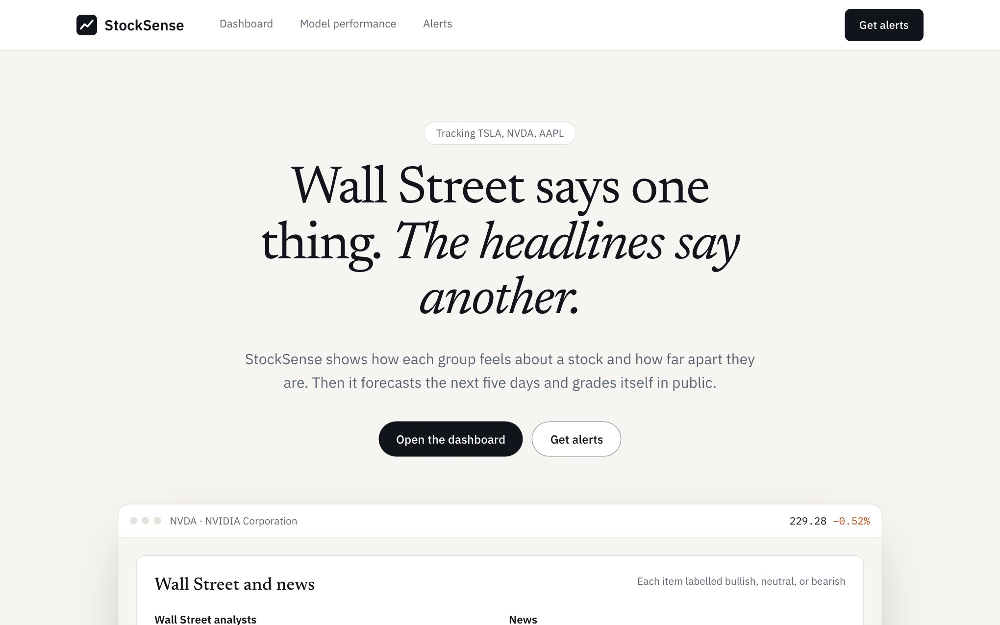
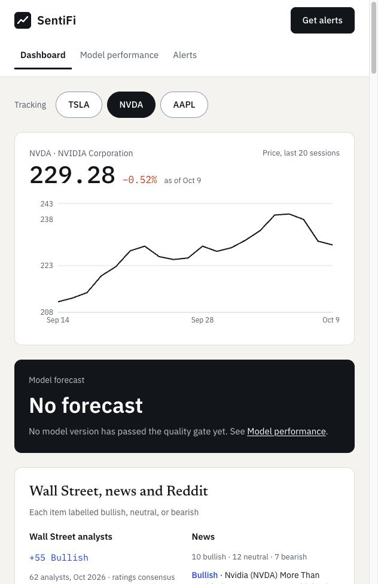
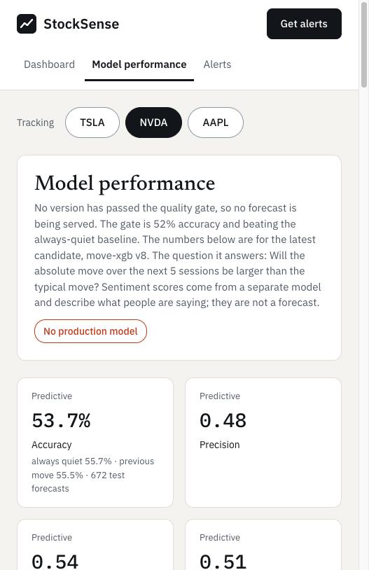

# ground-news-for-stocks:

[](https://github.com/aisha-sk/stock-wiki/actions/workflows/ci.yml)

**StockSense** shows how different groups feel about a stock, how far apart they are, and what a
model makes of the next five trading days. Then it grades its own forecasts in public, misses
included.

**Live site: https://stock-wiki-xi.vercel.app** (the API sleeps when idle, so the first load can
take up to a minute)

> Research and education only. Nothing here is financial advice, and past forecasts do not
> guarantee future results.



Built in 24 hours by two people: [@aisha-sk](https://github.com/aisha-sk) on the web app and
API, [@SubaitaM](https://github.com/SubaitaM) on data, sentiment and the forecasting model.

## What it does

| Page | Question it answers |
|---|---|
| Landing (`/`) | What is this, and why should I care? Built from live data, not mock-ups. |
| Dashboard | What is going on with this stock right now? Price, what analysts, news and Reddit each say, and the headlines behind each score. |
| Model performance | Can I trust the forecasts? Accuracy beside trivial baselines, every model version and whether it passed the quality gate, and a hit-and-miss log. |
| Alerts | Tell me when the story changes. Sign up for a stock and a trigger, and preview the email. |



## What we measured

From the artifacts generated on 2026-10-11 UTC. The live numbers are on the Model performance
page. How each one is computed: [docs/METHODOLOGY.md](docs/METHODOLOGY.md).

The model estimates whether the next 5 sessions will be a larger move than usual, in either
direction.

| Measure | Result |
|---|---|
| Accuracy, current version (XGBoost) | 53.7% over 672 out-of-sample forecasts |
| Baseline: always predict a quiet week | 55.7% |
| Baseline: repeat the previous week's move size | 55.5% |
| Model versions trained | 8 |
| Versions that passed the quality gate | 0 |
| Forecast log | 92 of 180 resolved forecasts correct (51.1%), 3 pending |

**The model clears 52% but does not beat always guessing a quiet week.** Version 8 was
rejected under the rule in force when it ran, which also required beating that baseline, so
the site serves no forecast until the pipeline runs again. The gate is now 52% alone; see
[docs/METHODOLOGY.md](docs/METHODOLOGY.md#5-the-gate).



## How it works

```
ml/  ──▶  data/artifacts/*.json  ──▶  api/ (FastAPI)  ──▶  web/ (Next.js)
                    │
                    └──▶  agent/ (MCP server, explain agent)
```

1. **Collect.** The pipeline pulls daily prices, news headlines and analyst ratings.
2. **Score.** FinBERT scores each headline from -100 (bearish) to +100 (bullish). Analyst
   scores come from buy, hold and sell counts, and are labelled as a ratings consensus.
3. **Forecast.** XGBoost is trained with walk-forward validation, so the model is only ever
   tested on days it has not seen. Runs are tracked in MLflow.
4. **Gate.** A version serves forecasts only if its accuracy reaches 52%.
5. **Publish.** The pipeline writes four kinds of JSON file. The API serves them unchanged and
   the web app renders them.

The two lanes meet at exactly one place, the JSON shapes in
[docs/CONTRACT.md](docs/CONTRACT.md). `scripts/validate_contracts.py` checks any data folder
against it, and CI runs that on every pull request.

## Run it locally

You need Python 3.11 and Node 20. From the repo root:

```bash
python3 -m venv api/.venv && api/.venv/bin/pip install -r api/requirements.txt
```

```bash
DATA_DIR=data/artifacts api/.venv/bin/uvicorn app.main:app --app-dir api --port 8000
```

In a second terminal:

```bash
cd web && npm install && npm run dev
```

Open http://localhost:3000. Leave out `DATA_DIR=data/artifacts` to run on the demo fixtures;
the site then shows a "Demo data" badge.

To rebuild the data yourself, see `ml/README.md`. To deploy, see
[docs/DEPLOY.md](docs/DEPLOY.md).

## The agent and the MCP server

Both are optional and read only the published data. Details in [agent/README.md](agent/README.md).

- **Explain agent.** The dashboard's "Why do they disagree?" panel asks Claude to explain the
  gap for one stock. An answer is only returned if every headline it cites is one we published.
  It needs `ANTHROPIC_API_KEY` on the server, and each answer costs money. Without a key the
  panel says the explainer is not set up.
- **MCP server.** `python -m agent.mcp_server` lets an MCP client such as Claude Code query
  sentiment, headlines, forecasts and the track record. No key needed.

## Repo layout

| Path | What | Owner |
|---|---|---|
| `web/` | Next.js app: landing page, dashboard, model performance, alerts | SWE |
| `api/` | FastAPI service, alert sign-ups, Dockerfile | SWE |
| `ml/` | Ingestion, sentiment scoring, forecasting model, MLflow, quality gate | DS/ML |
| `data/artifacts/` | Real pipeline output, served by the API | DS/ML |
| `agent/` | MCP server and the explain agent | SWE |
| `contracts/` | JSON Schemas and example payloads | Shared |
| `scripts/validate_contracts.py` | Checks any data directory against the contract | Shared |
| `docs/` | [Contract](docs/CONTRACT.md), [plan](docs/PLAN.md), [deploy](docs/DEPLOY.md), [demo script](docs/DEMO.md), [status](docs/STATUS.md) | Shared |

If you work with an AI coding agent, it reads [AGENTS.md](AGENTS.md).

## Limitations

- **Reddit is not in the data.** Reddit ingestion is written and leaves the source out when
  Reddit refuses a request. Every run on 2026-10-10 got HTTP 429 (rate limited), so every
  stock currently shows analysts and news only.
- **Three stocks.** TSLA, NVDA and AAPL. The sample is small: with 672 test forecasts the margin
  of error is about ±4 points, so the model and both baselines are not clearly apart.
- **Headlines only.** Sentiment is scored from titles, not article text.
- **The track record is a backtest for now.** A live five-day forecast needs five trading days
  to resolve, so the hit-and-miss rows are out-of-sample test predictions and are labelled so.
- **Alerts are stored, not sent.** No email leaves the system.
- **The data is a snapshot.** It is whatever the pipeline last published to `main`.
- **Duplicate model versions.** Versions 4 to 7 in the registry are identical reruns, kept
  because the registry is append-only. The pipeline now skips identical reruns.

## What we would do next

- Run the pipeline on a schedule, so data stays fresh and live forecasts accumulate
- Train on more stocks and more history
- Get Reddit working, or replace it with another retail source
- Send real alert emails, and move sign-ups from SQLite to Postgres
- Hand-label headlines to measure the sentiment scorer itself
