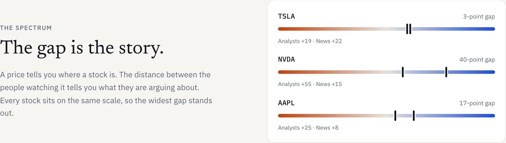
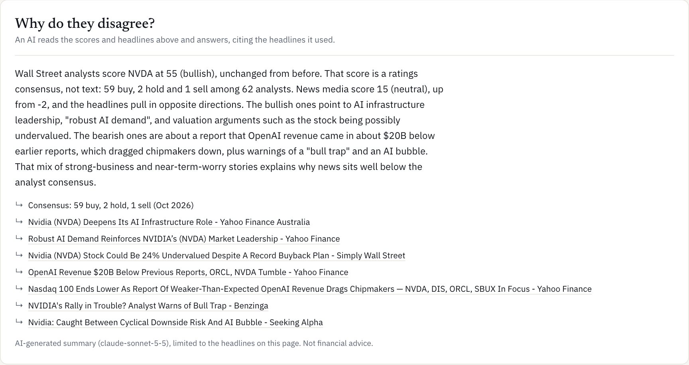
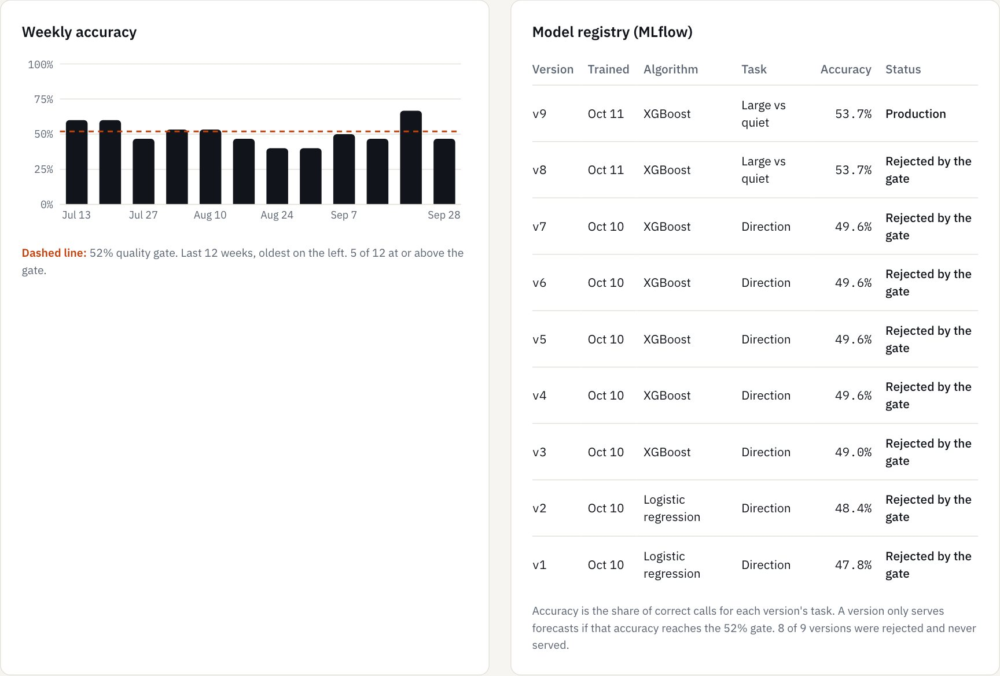
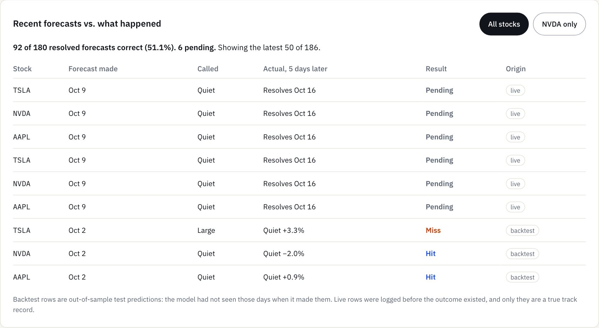
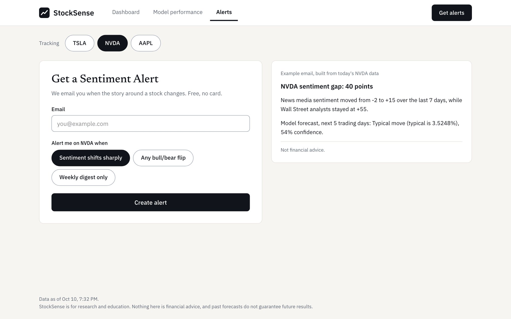
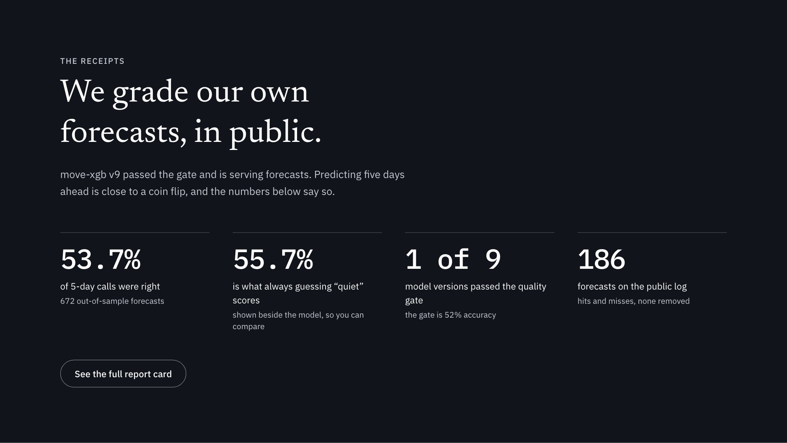
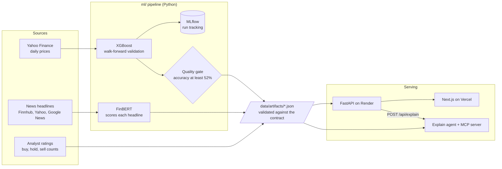

# StockSense

**Ground News, but for stocks.** See what Wall Street analysts and the news each say about a
stock, how far apart they are, and what a model makes of the next five trading days. Then
watch it grade its own forecasts in public, misses included.

[](https://github.com/aisha-sk/stock-wiki/actions/workflows/ci.yml)

**Live site: https://stock-wiki-xi.vercel.app** (the API sleeps when idle, so the first load can
take up to a minute)

> Research and education only. Nothing here is financial advice, and past forecasts do not
> guarantee future results.


Built in about a day by two people, each working with an AI coding agent:
[@aisha-sk](https://github.com/aisha-sk) with Claude Code on the web app, API and agent, and
[@SubaitaM](https://github.com/SubaitaM) with Cursor on data, sentiment and the forecasting
model. [How we split it and what we learned](#how-two-people-and-two-ai-agents-built-it) is
further down.

## Contents

- [The idea](#the-idea)
- [A tour of the site](#a-tour-of-the-site)
- [What we measured](#what-we-measured)
- [How it works](#how-it-works)
- [Tech stack](#tech-stack)
- [Who built what](#who-built-what)
- [How two people and two AI agents built it](#how-two-people-and-two-ai-agents-built-it)
- [Limitations](#limitations)
- [Run it locally](#run-it-locally)
- [Repo layout](#repo-layout)
- [What we would do next](#what-we-would-do-next)

## The idea

A normal finance site shows you a price. It does not show you that analysts are strongly
positive on a stock while the week's headlines are lukewarm, and that disagreement is often the
more interesting fact.

StockSense puts each group on the same scale, from -100 (bearish) to +100 (bullish), and shows
the gap between them. Every score links back to the headlines that produced it.

The second half of the idea is trust. Anyone can say "our AI predicts stocks". StockSense
publishes the model's accuracy next to two trivial baselines, lists every version it trained
and whether that version passed a quality gate, and keeps a log of forecasts with hits and
misses. When the numbers are unflattering, they stay on the page.

## A tour of the site

### Landing page

The home page is a pitch made from live data. The product window in the hero is the real
sentiment card for whichever stock has the widest gap right now, and this section puts all
three stocks on one scale.



### Dashboard

Pick a stock. The top row is the price over the last 20 sessions and the model's forecast for
the next five. Below it, analysts and news sit side by side, with each headline labelled
bullish, neutral or bearish.


The forecast is about the **size** of the move, not its direction: will the next five sessions
move more than this stock usually does, either way?

### Why do they disagree?

One click asks an AI agent to explain the gap. It reads that stock's scores and headlines
through a small set of tools, then writes a short answer. The answer is only returned if every
headline it cites is one StockSense actually published, so each claim can be checked against
the list underneath.



### Model performance

The report card. Accuracy sits next to both baselines, on forecasts the model had never seen.


Below that, accuracy week by week against the gate, and the full registry. Eight of the nine
versions were rejected and never served a forecast.



Then the forecast log, with nothing removed. Rows marked "backtest" are out-of-sample test
predictions. Rows marked "live" were logged before the outcome existed.



### Alerts

Sign up for a stock and a trigger. The example email on the right is built from that stock's
current data. Sign-ups are stored; no email is sent yet.



## What we measured

From the artifacts generated on 2026-10-11 UTC. The live numbers are on the
[Model performance page](https://stock-wiki-xi.vercel.app/model), and how each one is computed
is in [docs/METHODOLOGY.md](docs/METHODOLOGY.md).

| Measure | Result |
|---|---|
| Accuracy, current version (XGBoost, version 9) | 53.7% over 672 out-of-sample forecasts |
| Baseline: always predict a quiet week | 55.7% |
| Baseline: repeat the previous week's move size | 55.5% |
| Model versions trained | 9 |
| Versions that passed the quality gate | 1 (version 9, in production) |
| Forecast log | 92 of 180 resolved forecasts correct (51.1%), 6 pending |



**Read this result plainly.** The model clears the 52% gate, so it serves forecasts. It does
not beat always guessing "a quiet week", and with 672 test forecasts the margin of error is
about ±4 points, so the model and both baselines are not clearly apart. It has no demonstrated
edge.

How it got there matters too, so here it is in order:

1. The gate threshold, 52%, was fixed at kickoff, before any model existed.
2. Versions 1 to 7 predicted **direction** (up or down). They scored 47.8% to 49.6%, below a
   coin flip, and all were rejected.
3. We changed the question to **move size** (larger than usual, or not). Version 8 scored 53.7%.
4. A second gate rule, "must also beat always-quiet", was added that evening, and version 8 was
   rejected under it. The rule was then removed, and version 9, an identical rerun, was
   promoted.

Changing the question and the gate rule after seeing results is exactly what a pre-set gate
is meant to prevent, and we did both. The threshold itself never moved, every rejected version
is still in the registry, and the baselines are printed next to the model on every page so a
reader can judge for themselves. The pipeline, the validation and the public record are the
solid part of this project. The forecast is not.

## How it works



1. **Collect.** The pipeline pulls two years of daily prices, recent news headlines and analyst
   buy, hold and sell counts.
2. **Score.** [FinBERT](https://huggingface.co/ProsusAI/finbert), a language model trained on
   financial text, scores each headline from -100 to +100. Analyst scores are computed from the
   rating counts and labelled "ratings consensus", because they are not text sentiment.
3. **Forecast.** XGBoost is trained on price features (returns, volatility, RSI, volume) plus
   last week's news score. Validation is walk-forward: train on the past, test on the next
   block, roll forward, with a five-session purge so no label overlaps the test period. There
   are no random splits anywhere.
4. **Gate.** A version serves forecasts only if its accuracy reaches the threshold. Every run is
   tracked in MLflow, and every version stays in the registry with its verdict.
5. **Publish.** The pipeline writes four kinds of JSON file and validates them. The API serves
   those files unchanged, and the web app renders them.
6. **Explain.** The agent and the MCP server read the same files, so they cannot produce a
   number the dashboard does not also show.

Two scheduled GitHub Actions workflows are set up: a weekday run that refreshes data and logs
new forecasts, and a Sunday run that retrains behind the gate.

### The contract

The two halves of the project meet at exactly one place: the JSON shapes in
[docs/CONTRACT.md](docs/CONTRACT.md), with machine-checkable schemas in `contracts/schemas/` and
fake example payloads in `contracts/examples/`.

`scripts/validate_contracts.py` checks any data folder against the schemas, plus the rules a
schema cannot express: labels must match scores, the gap must equal the highest score minus the
lowest, a resolved forecast must be marked hit exactly when the call matched the outcome. CI
runs it on every pull request, and the API checks each file again before serving it.

## Tech stack

| Layer | What we used |
|---|---|
| Web | Next.js 16 (App Router), TypeScript, Tailwind CSS 4, Recharts. Newsreader for headings, IBM Plex Sans and Mono for text and numbers. |
| API | FastAPI, Pydantic 2, SQLite for alert sign-ups, Docker |
| Data and ML | pandas, scikit-learn, XGBoost, FinBERT through Hugging Face Transformers, MLflow, yfinance |
| Agent | Anthropic SDK (Claude) with tool use, Model Context Protocol Python SDK |
| Contract | JSON Schema, with a Python validator |
| CI and automation | GitHub Actions: five checks per pull request, plus scheduled forecast and retraining workflows |
| Hosting | Vercel for the web app, Render for the API |

## Who built what

We split by lane, with a strict rule that neither side edits the other's folders.

| | Aisha ([@aisha-sk](https://github.com/aisha-sk)) | Subaita ([@SubaitaM](https://github.com/SubaitaM)) |
|---|---|---|
| Role | Software engineering | Data science and ML |
| AI agent | Claude Code | Cursor |
| Folders | `web/`, `api/`, `agent/`, `.github/` | `ml/`, `data/artifacts/` |
| Pull requests merged | 20 | 14 |

**Aisha built:**

- The FastAPI service: eight endpoints, strict validation of every file before it is served,
  one error shape for every failure, and 56 tests
- The Next.js app: the landing page, dashboard, model performance page and alerts page,
  including loading, error and empty states for every nullable field in the contract
- Alert sign-ups with SQLite storage and the example email builder
- The explain agent and the MCP server, with 21 tests
- CI, the Dockerfile, the Render blueprint and the deploy to Vercel and Render
- The contract, validator and example fixtures at kickoff, and the plan and ticket board

**Subaita built:**

- Price, news and analyst ingestion, including the filter that drops option-chain and
  quote pages from the headlines
- FinBERT scoring and the per-group aggregation, the gap calculation and its summary sentence
- Feature engineering and the walk-forward training and evaluation code, with leakage tests
- Nine model versions across two algorithms and two forecast targets
- MLflow tracking, the quality gate and the append-only registry
- The publisher that writes and validates the artifact files, and the live forecast log with
  its resolver
- The scheduled forecast and retraining workflows
- [docs/METHODOLOGY.md](docs/METHODOLOGY.md), and 51 fast tests

**Shared:** the contract, the plan, three checkpoints where we ran both halves together, and
the decisions about scope, the gate and what to cut.

The lanes were crossed a few times, each time on purpose and noted in the pull request: Subaita
updated web components when the forecast target changed, and Aisha changed a headline filter,
the Reddit switch and the product name inside `ml/`.

## How two people and two AI agents built it

We were in different cities, two hours apart, each directing a different AI coding agent. The
agents never talked to each other. Everything below exists to make that work.

### 1. Agree the contract before writing any feature

The first commit, at 9:52 pm on a Friday, contained no application code. It had the JSON
contract, schemas, example payloads, a validator, a three-flow plan and
[`AGENTS.md`](AGENTS.md), a single file of rules that both Claude Code and Cursor read.

That one decision is why two people could work in parallel. The web app and API were built
against the fake example files from the first minute. The ML pipeline's only job was to produce
files in the same shape. Switching the site from fake data to real data was one environment
variable.

### 2. Give both agents the same rules

`AGENTS.md` says which folders each lane may edit, that no agent may invent or rename a field,
that the web app hardcodes no numbers, that validation is walk-forward only, that no metric
goes into a file unless code computed it, and that nothing may be worded as financial advice.
`CLAUDE.md` imports it, so there is one source of truth for both tools.

### 3. Work in tickets, with three checkpoints

The plan was three flows, each ending in something that runs: a working dashboard for one stock,
then real model evaluation and tracking for three stocks, then alerts, deployment and the agent.
That became 27 GitHub issues, each with tasks, acceptance criteria and dependencies written so
an agent could act on it. At each checkpoint we pointed the API at the real artifacts and
compared the screen to the JSON, number by number.

### 4. Hand over through a status file

When one of us merged a batch of work, we updated [docs/STATUS.md](docs/STATUS.md): what
changed, what it means for the other lane, known problems, and what to do next. The other
person's agent read that file after pulling. It replaced a lot of messages.

### 5. Let checks, not trust, catch mistakes

Every pull request runs five jobs: contract validation, API tests, a web lint, type check and
build, fast ML tests, and agent tests. On the web side, each feature was also exercised in a real
browser against the running API before its pull request was opened.

### What the agents did, and what we did

The agents wrote most of the code, the tests and the documentation, and ran the checks. We
decided what to build, what to cut, where the lanes were, when a result was good enough, and
what the site was allowed to claim. The clearest example: when a model fails its gate, it is easy
to keep changing things until something passes. Deciding whether that is honest is a human call,
and we did not get it entirely right (see [What we measured](#what-we-measured)).

### What went wrong

Being specific about this is more useful than a clean story.

| Problem | What happened | What we do now |
|---|---|---|
| Stacked pull requests | Each PR targeted the previous branch, so several "merged" without reaching `main`. One side's work sat on a side branch until we noticed. | Every PR targets `main`, one ticket each, merged before the next starts. |
| Contract changes without sign-off | Our own rule says a contract change needs the other person's approval. Each of us merged one without it. | The rule stands; both changes were flagged in the status file afterwards. |
| Moving the goalposts | The forecast question and a gate rule both changed after results were in. | Stated in full above and in the methodology, with every rejected version kept. |
| A source we were not allowed to use | The first pipeline requested Reddit's public feeds. Reddit requires approval before any access to its data, and every request was refused. | The Reddit fetch is switched off and the site names only the groups it has data for. |
| Flaky build | A CI run failed while downloading fonts from Google during the build. | Fonts are bundled in the app. |
| "Works on my machine" | The first CI run failed on a type that only existed after a local build. | Fixed, and a reason CI runs on a clean checkout. |
| Duplicate files | The repo sat in an iCloud-synced folder, which created dozens of conflict copies when switching branches. One was committed by mistake. | Removed and ignored; keep repos out of synced folders. |
| Stale claims | The site and README described the gate, the name and the data sources in ways that had stopped being true after later changes. | Each was corrected, and screenshots are retaken from the live site. |

### Timeline

| When (Edmonton time) | What |
|---|---|
| Fri Oct 9, 9:52 pm | First commit: contract, schemas, fixtures, validator, plan, agent rules |
| Sat Oct 10, 3:30 pm | Flow 1 on `main`: the dashboard runs on real pipeline data for three stocks |
| Sat 4:00 pm | CI live. Model performance page, error states and the gate merged shortly after |
| Sat 6:00 to 6:30 pm | Alerts, the landing page, then the MCP server and explain agent |
| Sat 6:40 pm | Forecast target changed from direction to move size |
| Sat 7:00 pm | Deployed: API on Render, web app on Vercel |
| Sat 7:40 pm | Scheduled workflows merged, version 9 promoted, Reddit switched off |
| Sun Oct 11 | AI explainer switched on with a live key; copy and screenshots brought up to date |

About 21 hours from the first commit to a public URL. As of this writing: about 80 commits and
34 merged pull requests.

## Limitations

- **The forecast has no demonstrated edge.** It passes its gate and scores below a baseline
  that always says "quiet". See [What we measured](#what-we-measured).
- **Two groups, not three.** Reddit is switched off until Reddit approves API access, so the
  site compares analysts and news only.
- **Three stocks.** TSLA, NVDA and AAPL. The sample is small.
- **Headlines only.** Sentiment is scored from titles, not article text.
- **The track record is mostly a backtest.** A live five-day forecast needs five trading days
  to resolve, so most hit-and-miss rows are out-of-sample test predictions and are labelled so.
- **Alerts are stored, not sent.** No email leaves the system.
- **The data is a snapshot.** The site shows whatever the pipeline last published. The footer
  of every page says when.
- **Free hosting.** The API sleeps when idle, and alert sign-ups are lost when it redeploys.
- **The explainer costs money per answer** and needs an Anthropic key on the server. Answers
  are cached and rate-limited.
- **Duplicate model versions.** Versions 4 to 7 are identical reruns, kept because the registry
  is append-only. The pipeline now skips identical reruns.

## Run it locally

You need Python 3.11 and Node 20. From the repo root:

```bash
python3 -m venv api/.venv && api/.venv/bin/pip install -r api/requirements.txt
```

```bash
DATA_DIR=data/artifacts api/.venv/bin/uvicorn app.main:app --app-dir api --port 8000
```

In a second terminal:

```bash
cd web && npm install && npm run dev
```

Open http://localhost:3000. Leave out `DATA_DIR=data/artifacts` to run on the demo fixtures;
the site then shows a "Demo data" badge.

| To | See |
|---|---|
| Rebuild the data | `ml/README.md`, and the commands in [AGENTS.md](AGENTS.md) |
| Check a data folder against the contract | `python scripts/validate_contracts.py data/artifacts` |
| Turn on the explainer | Set `ANTHROPIC_API_KEY`; details in [agent/README.md](agent/README.md) |
| Use the MCP server from Claude Code or another client | [agent/README.md](agent/README.md) |
| Deploy | [docs/DEPLOY.md](docs/DEPLOY.md) |
| Give a three-minute demo | [docs/DEMO.md](docs/DEMO.md) |

## Repo layout

| Path | What | Owner |
|---|---|---|
| `web/` | Next.js app: landing page, dashboard, model performance, alerts | Aisha |
| `api/` | FastAPI service, alert sign-ups, Dockerfile | Aisha |
| `agent/` | Explain agent and MCP server | Aisha |
| `ml/` | Ingestion, sentiment scoring, forecasting model, MLflow, quality gate | Subaita |
| `data/artifacts/` | Real pipeline output, served by the API | Subaita |
| `contracts/` | JSON Schemas and example payloads | Shared |
| `scripts/validate_contracts.py` | Checks any data directory against the contract | Shared |
| `.github/workflows/` | CI, the weekday forecast run and the Sunday retraining run | Both |
| `docs/` | [Contract](docs/CONTRACT.md), [methodology](docs/METHODOLOGY.md), [plan](docs/PLAN.md), [deploy](docs/DEPLOY.md), [demo script](docs/DEMO.md), [status](docs/STATUS.md) | Shared |
| `design/` | The original mock, under the project's first name | Reference |

## What we would do next

- Let the scheduled runs accumulate live forecasts, so the track record stops being a backtest
- Train on more stocks and more history, and make "beats the baseline" part of the gate for good
- Add a retail-investor voice: request Reddit API access, or use a licensed social-sentiment feed
- Send real alert emails, and move sign-ups from SQLite to Postgres
- Hand-label a few hundred headlines to measure the sentiment scorer itself
- Run the API on a paid instance so the site is awake around the clock
